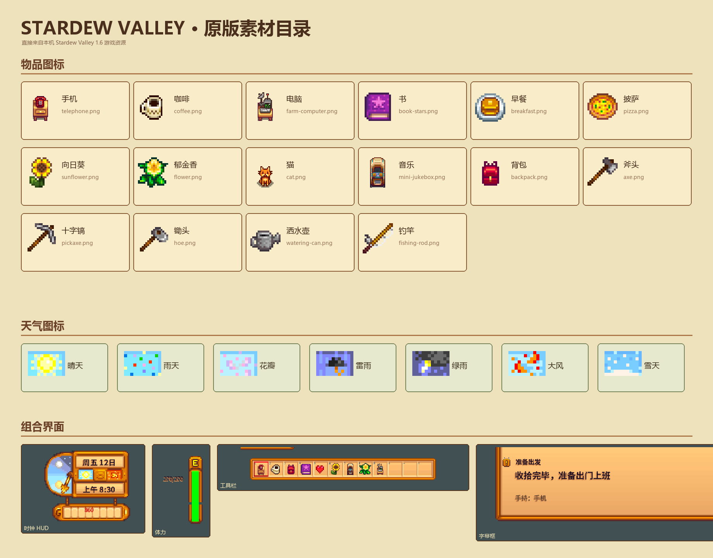
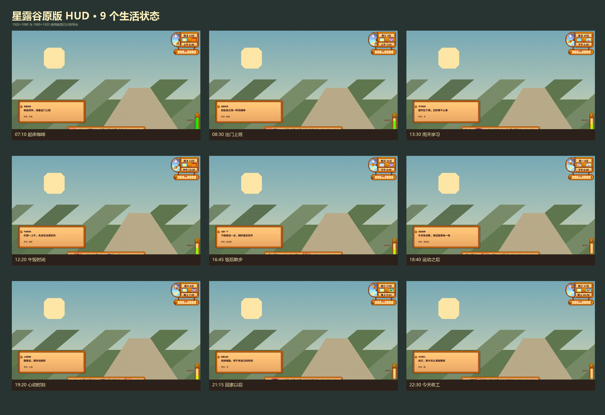
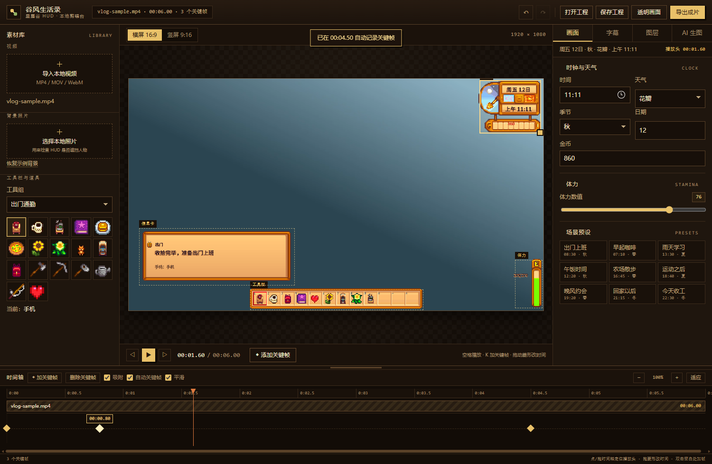

# 星露谷原版 HUD · 生活 Vlog 叠层

这一版直接使用你本机《星露谷物语》1.6.15 的资源。右上角时钟、天气、季节、金币栏、右侧体力条、底部 12 格工具栏和字幕框都由游戏原版贴图组成，文字使用游戏的中文 SpriteFont。

开发交接、源码构建方式和已知问题见 `HANDOFF.md`。

## 默认画面

- 日期：周五 12日
- 时间：上午 8:30
- 天气：晴朗
- 季节：秋
- 体力：100%（原版数值 270/270）
- 当前物品：Telephone `(BC)214`，显示在工具栏第一格并高亮
- 字幕：收拾完毕，准备出门上班

## 使用方法

1. 解压整个文件夹。
2. 直接双击 `overlay.html` 即可，不需要本地服务器；也可以运行 `start-overlay.cmd`。
3. 左栏“素材库”导入视频与背景照片，中栏监看台调画幅和播放，右栏检查器改画面、字幕、图层和 AI 图片。
4. 可以放入一张真实 Vlog 截图，用来检查人物和 HUD 是否遮挡。
5. 点“复制 OBS 浏览器地址”，新链接会带 `clean=1`，只保留透明 HUD。
6. OBS 添加“浏览器”来源，画幅设置 1920×1080 或 1080×1920。

如果放进剪映、PR、达芬奇，直接使用 `previews/` 中对应状态的透明 PNG。

如果出现控件或 HUD 空白，请确认使用的是这一版文件夹里的 `app-bundle.js`；离线版已经把字体数据和全部绘图逻辑打包进这个文件。

## 工作区结构

界面按视频剪辑软件的惯例分成三栏加一条时间轴，深色木工作台里只让原版 HUD 发亮：

| 区域 | 位置 | 内容 |
| --- | --- | --- |
| 素材库 | 左侧 | 导入视频、背景照片、工具组与 17 个物品 |
| 监看台 | 中间 | 画幅切换、HUD 预览、拖动/缩放组件、播放控制与时间码 |
| 检查器 | 右侧 | 画面、字幕、图层、AI 生图四组属性；顶部常驻当前状态摘要 |
| 时间轴 | 底部通栏 | 视频轨、关键帧菱形、播放头、吸附/自动关键帧/平滑、缩放；拖动顶部横条可调高度 |

- 顶栏右侧是撤销 / 重做、打开、保存、透明画面和“导出成片”；导出面板以弹窗打开，包含导出摘要、进度日志、工程信息和 OBS 地址。
- 没有导入视频时“导出成片”是禁用状态，导入后自动可用。
- 窗口较窄时素材库收进抽屉，用顶栏的 ▤ 按钮打开；预览始终按 16:9 或 9:16 等比缩放。
- “场景预设”在右侧检查器的“画面”页底部，点一下就能套用整套游戏内状态。
- 图层位置除了拖动，还可以在“图层”页直接输入 X / Y 坐标和缩放百分比。

## 时间轴

时间轴固定在底部，视频轨在上、关键帧在下，所有关键帧都显示为菱形：

- 视频轨显示当前视频文件名和时长，标尺和时间轴总长按视频与最后一个关键帧取较大值。
- 在时间轴空白处按下并拖动，可以定位播放头，拖动时会显示时间气泡。
- “◆ 添加关键帧”在播放器右侧和时间轴工具条各有一个，都会在当前播放头位置落帧；该时间已有关键帧时只更新它，不会重复添加。
- 还没导入视频时，加帧和导出都是禁用状态，时间轴会提示先导入视频。
- 拖动菱形可以改变关键帧的时间；打开“吸附”后会吸附到其他关键帧、播放头和片头片尾。
- 双击时间轴空白处，直接在该时间点新增关键帧。
- 用 `−` / `＋` / `适应` 缩放时间轴，也可以按住 Ctrl 滚动鼠标滚轮。放大后时间轴可以横向滚动，播放时播放头会自动跟随。
- 播放头正好落在关键帧上时，菱形会高亮；绿色小点表示该帧改变了图层位置。
- 拖动时间轴顶部的横条可以改变整条时间轴的高度，监看台会自动让出空间。

### 自动关键帧

默认开启“自动关键帧”：

- 播放头正好停在某个关键帧上时，修改会直接更新这一帧。
- 播放头不在关键帧上时，第一次修改会自动在播放头位置记录一帧，并弹出提示。
- 取消勾选后，修改会写回最近的关键帧（不新增帧），适合只想修整某一帧的场合。

## 撤销与重做

- 顶部 `↶ 撤销` / `↷ 重做`，或使用 `Ctrl+Z` / `Ctrl+Shift+Z`（`Ctrl+Y` 也可以重做）。
- 一次拖动、一次滑动条调整只算一步，不会产生几十步历史。
- 可撤销的内容包括：画面参数、字幕、关键帧增删与移动、图层位置与缩放、替换图片、切换画幅、应用预设。

## 快捷键

| 按键 | 作用 |
| --- | --- |
| 空格 | 播放 / 暂停 |
| ← / → | 后退 / 前进 0.1 秒（按住 Shift 为 1 秒） |
| K | 在当前时间添加关键帧 |
| Delete / Backspace | 删除所选关键帧 |
| `[` / `]` | 跳到上一个 / 下一个关键帧 |
| Ctrl+Z / Ctrl+Shift+Z | 撤销 / 重做 |
| Ctrl+S | 保存工程 |
| E / Esc | 切换透明画面（导出中按 Esc 为取消导出） |

## 网页内剪视频

1. 在“剪辑”里导入 MP4、MOV 或 WebM。
2. 拖动播放头到目标时间，调整天气、时间、体力、工具和字幕；开启自动关键帧时，改动会自动落成关键帧。
3. 也可以改完状态后点“添加关键帧”，把当前状态固定在这一时间点。
4. 勾选“平滑时间/体力/图层”时，两帧之间的游戏时间、体力、金币、图层位置和缩放会逐渐变化；天气、工具栏、字幕和图片在关键帧处切换。
5. 点“导出当前关键帧动画”。编辑器会实时播放原视频并合成 HUD，优先下载 H.264 编码、带 AAC 音轨的 MP4；浏览器不支持 MP4 录制时才自动改用 WebM。
6. 导出过程中可以直接点“取消导出”，右侧日志会记录编码、音频来源、进度和取消原因。
7. 用“保存工程”下载 JSON；重新打开网页后先点“加载工程”，再导入原视频即可继续编辑。

导出速度约等于视频原时长。所有原版贴图和字体绘图数据都已嵌入离线包，所以直接双击页面也能正常导出；录制的 Canvas 不会因 `file://` 安全限制变成空白。

## 图层与自定义图片

- 时钟、体力、工具栏、信息卡可以逐个隐藏。
- 在视频预览上直接拖动组件；拖动组件右下角方块可以缩放。
- “当前图层大小”滑块提供精确缩放。
- “替换图片”会用 PNG/WebP/JPEG 替换选中的整个组件。
- “替换当前物品”可以替换工具栏当前选中的图标。
- “恢复原版位置”和“恢复默认图片”可以撤销布局或图片替换。

位置、缩放和替换的图片都写进当前时间的关键帧，所以可以让 HUD 在视频里移动、放大或在某个时间点换图；两帧之间勾选“平滑”就会平滑过渡。

## 工程文件与自动保存

- 工程是带版本号的 JSON（当前 `version: 2`），包含画幅、关键帧、图层位置与缩放、自定义图片、平滑开关和视频信息。
- 保存时会记录视频文件名、大小、时长、分辨率和（测量到的）帧率。
- 打开工程但还没导入视频时，“剪辑”页会提示工程对应的视频规格，方便你重新选择同一个文件。
- 每次修改后会自动保存到浏览器本地（约 1.2 秒防抖）。下次打开页面时，顶部会出现“发现自动保存”提示条，可以一键恢复或忽略。
- 工程体积超过约 4.5 MB 时会自动关闭本地自动保存，避免浏览器存储超限；手动“保存工程”不受影响。
- 旧版（`version: 1`）工程可以直接加载，编辑器会自动迁移到新格式。

## AI 像素图片

页面带一个可选的 OpenAI Images API 生图入口。先运行 `start-overlay.cmd`，再在“AI 像素图片”里填写 API Key、描述和目标图层。

- 密钥只在当前页面内存与本地代理之间传递，不写进工程文件。
- 默认模型为 `gpt-image-2.5-flare`，也可以在输入框中更换。
- 请求提示会自动补充透明背景、硬边像素、无文字、居中、暖色游戏界面等约束。
- 没有 API Key 时，仍可手动上传任意 AI 生成的 PNG 来替换组件或物品。

图片接口来自 [OpenAI 官方 Image generation API](https://developers.openai.com/api/reference/resources/images/methods/generate)。

## 素材

- `assets/stardew/Cursors.png`：原版时钟、天气、季节、体力、金币等界面贴图。
- `assets/stardew/Cursors_1_6.png`：1.6 新增界面贴图。
- `assets/stardew/MenuTiles.png`：工具栏、选格和字幕框。
- `assets/stardew/springobjects.png`：完整普通物品图集。
- `assets/stardew/tools.png`：完整工具图集。
- `assets/stardew/Craftables.png`：大型可制作物图集。
- `assets/stardew/SpriteFont1-zh-CN.*`：对话字体和字形数据。
- `assets/stardew/SmallFont-zh-CN.*`：小字字体。
- `assets/stardew/tinyFont.*`：工具栏数字字体。
- `assets/items/`：已经提取好的 17 个常用生活物品。
- `assets/ui/`：已经裁好的时钟、天气、体力、工具栏和字幕组件。
- `previews/`：9 个生活状态，每个都包含横屏和竖屏透明 PNG。
- `previews/video-editor-demo.mp4`：网页自动合成的 MP4 关键帧导出测试片段。
- `previews/vlog-sample.mp4`：6 秒、1080p、带 AAC 音轨的干净测试片，适合直接导入试打关键帧。
- `asset-map.json`：界面资源坐标、人物物品 ID 和字体对应表。

## 状态示例







## 自动化测试

`qa/` 目录里有一套不依赖第三方库的浏览器回归测试（通过 Chrome DevTools Protocol 驱动本机 Edge/Chrome）：

```powershell
node qa/verify.mjs            # 全部用例：页面基线、时间轴、自动关键帧、撤销重做、工程、图层、导出
node qa/verify.mjs timeline   # 只跑某个分组
node qa/screens.mjs           # 重新生成参考截图
```

导出用例需要 `ffprobe` 校验编码，可用 `DSH_FFPROBE` 指定路径；找不到时会跳过编码断言。

## 修改原则

时钟框来自 `Cursors` 的 `333,431,71,43`，按游戏源码中的 4 倍比例绘制。天气使用 `317 + 天气编号 × 12, 421, 12, 8`，季节使用 `406, 441 + 季节编号 × 8, 12, 8`。工具栏采用 `MenuTiles` 的 `0,256,60,60` 九宫格，普通格子为第 10 个标准图块，选中格为第 56 个。

改完 `app.js`、`items.js`、`spritefont.js` 或 `assets/` 里的素材后，请在项目目录运行 `npm run build` 重新生成 `app-bundle.js`，页面加载的始终是后者。

这些原版素材来自本机 Steam 游戏文件，建议作为你自己的剪辑模板保存，不要把包含原版贴图的整个素材包继续公开分发。
